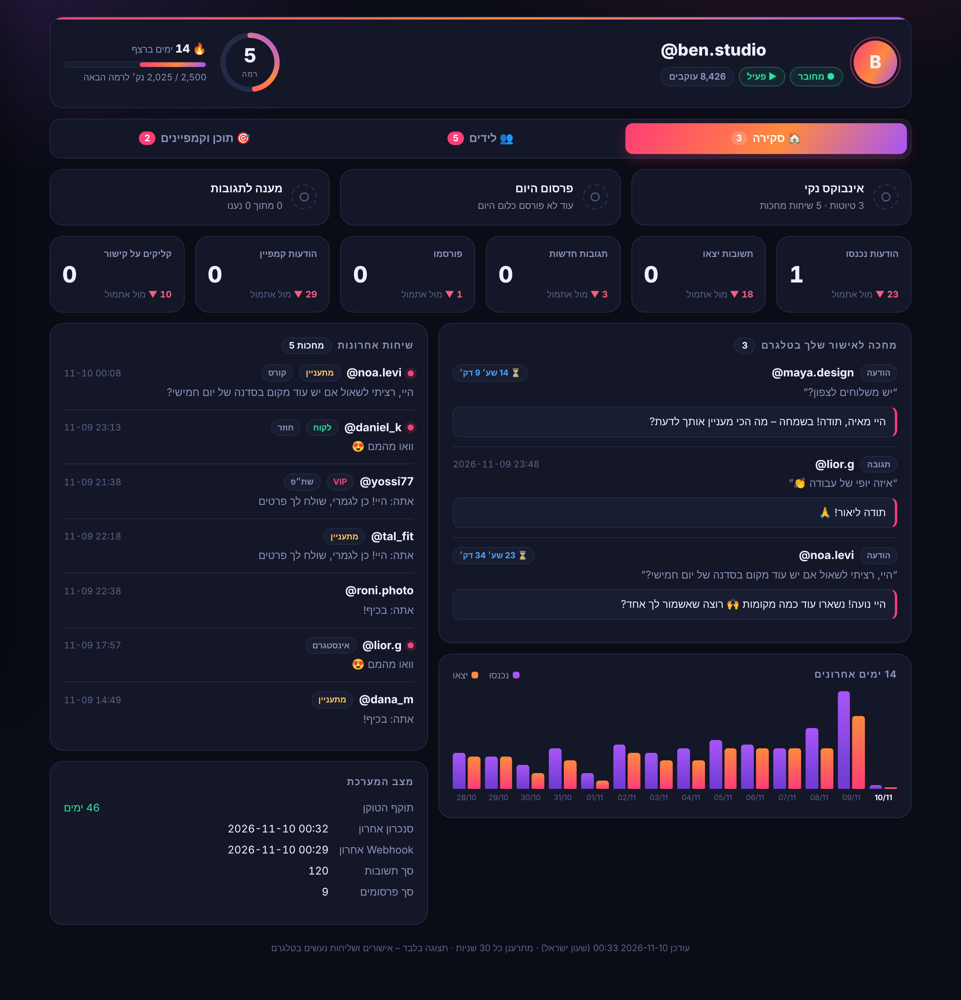
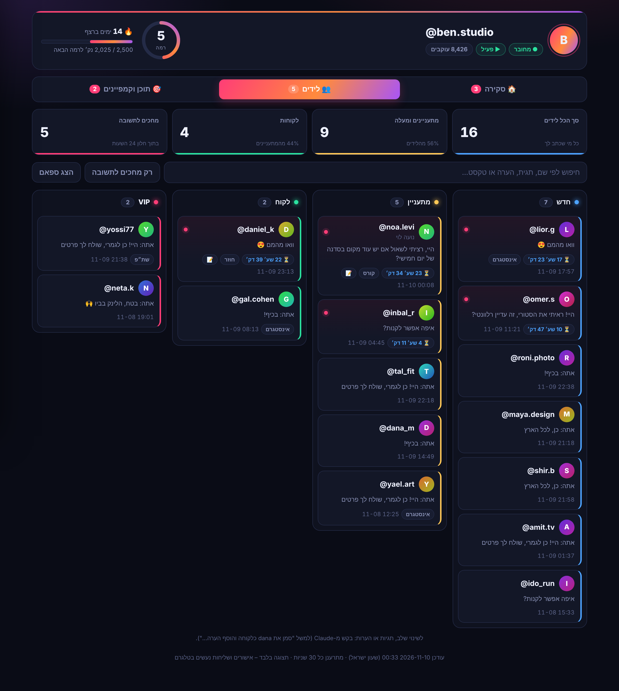

# IG Agent

סוכן אינסטגרם אישי לחשבון אחד. רץ תמיד על VPS, מנסח תשובות להודעות (DM) ולתגובות בקול שלך,
שולח אותן לאישור בטלגרם, וחושף כתובת MCP כדי שתוכל לנהל את החשבון ולפרסם תוכן מתוך צ׳אט של Claude.

**עיקרון מנחה: שום דבר לא נשלח ולא מתפרסם בלי אישור מפורש שלך** – אלא אם הדלקת במפורש `AUTO_SEND_*`,
או אישרת קמפיין (ראה "קמפיינים": שם מאשרים פעם אחת נוסח קבוע, והוא נשלח לכל מי שמגיב את מילת המפתח).


*לוח הבקרה עם נתוני הדגמה.*

> ⚠️ הקוד נבדק מקומית מול API מדומה (`npm test`). **הוא עדיין לא נבדק מול ה-API האמיתי של אינסטגרם.**
> לפני שסומכים עליו – לעבור על `docs/api-validation.md`.

## מה הוא עושה

| יכולת | איך |
|---|---|
| הודעות (DM) | הודעה נכנסת → המתנה של 45 שניות (למקרה שיש עוד) → טיוטה → כרטיס בטלגרם עם `שלח ✅` / `נסח מחדש 🔄` / `דלג ⏭` |
| תגובות לפוסטים | תגובה חדשה (עד 48 שעות) → טיוטה → כרטיס בטלגרם |
| עריכה | Reply על הכרטיס עם טקסט = החלפת הטיוטה (לא שולח). `/re קצר יותר` ב-Reply = ניסוח מחדש לפי הנחיה |
| העלאת מדיה | שולחים לבוט תמונה / וידאו / אלבום → כרטיס עם `פוסט` / `סטורי` / `ריל` / `קרוסלה` / `שמור לאחר כך` |
| תזמון | דרך Claude: "תזמן את תמונה 12 למחר ב-18:30" (שעון ישראל) |
| קמפיינים | מי שמגיב מילת מפתח ("לינק") מקבל הודעה פרטית עם קישור במעקב קליקים |
| לוח בקרה | דף ווב לצפייה בלבד: מה מחכה לך, שיחות, קמפיינים, ביצועים, רמה ורצף ימים |
| סיכום יומי | כל ערב בטלגרם (וגם `/today`): הודעות, תגובות, פרסומים, עוקבים וחשיפה |
| כרטיס ליד | שלב, תגיות והערות לכל שיחה – נכנסים לפרומפט כדי שהסוכן ידע עם מי הוא מדבר |
| Claude (MCP) | 35 כלים: סטטוס, שיחות, טיוטות, תגובות, מדיה, פרסום, תזמון, קמפיינים, ביצועים, דוחות סגנון |

## התקנה

דרישות: VPS עם Docker, דומיין שמצביע אליו, אפליקציית Meta עם **Instagram API with Instagram Login**,
חשבון אינסטגרם מקצועי (Business/Creator), בוט טלגרם, מפתח Anthropic API.

```bash
cp .env.example .env      # ולמלא את הערכים
mkdir -p data && sudo chown -R 1000:1000 data   # הקונטיינר רץ כמשתמש לא-root
docker compose up -d --build
```

1. **טלגרם:** צור בוט אצל @BotFather, שים את הטוקן ב-`.env`. הפעל, שלח לבוט `/start`, העתק את ה-Chat ID
   שהוא מחזיר ל-`TELEGRAM_CHAT_ID` והפעל מחדש. מרגע שה-ID מוגדר הבוט **מתעלם לחלוטין** מכל אחד אחר.
2. **Meta:** באפליקציה הגדר Redirect URI ל-`https://<DOMAIN>/auth/callback`, ו-Webhook ל-`https://<DOMAIN>/webhook`
   עם ה-`WEBHOOK_VERIFY_TOKEN` שלך. הירשם לשדות `messages`, `message_reactions`, `comments`.
   ההרשאות שהאפליקציה מבקשת: basic, manage_messages, manage_comments, content_publish, **manage_insights**
   (האחרונה נדרשת לנתוני הביצועים; אם התחברת לפני שנוספה – צריך להתחבר מחדש דרך `/auth/login`).
3. **חיבור אינסטגרם:** גלוש ל-`https://<DOMAIN>/auth/login` ואשר. תקבל אישור בטלגרם.
4. **Claude:** הוסף Custom Connector עם הכתובת `https://<DOMAIN>/mcp/<MCP_SECRET>`.
   הכתובת הזו היא סיסמה – מי שמחזיק בה שולט בחשבון. לא לשתף ולא להדביק בשום מקום.
5. **הקול שלך:** מלא את `style.md` (ראה למטה). בלי זה הטיוטות יהיו גנריות.
6. **לוח בקרה (רשות):** הגדר `DASHBOARD_SECRET` ופתח את `https://<DOMAIN>/dash/<DASHBOARD_SECRET>/`.

בדיקה: `https://<DOMAIN>/health` צריך להחזיר `"connected": true`.

## פקודות בטלגרם

| פקודה | מה היא עושה |
|---|---|
| `/status` | חיבור, מצב השהיה, טיוטות ממתינות, ימים לתוקף הטוקן, סנכרון ו-webhook אחרונים |
| `/today` | סיכום היום: הודעות, טיוטות, תגובות, פרסומים, קמפיינים, עוקבים וחשיפה, ומה מחכה לך |
| `/campaigns` | רשימת הקמפיינים עם נתונים וכפתורי השהיה / הפעלה |
| `/pending` | שולח מחדש את כל הכרטיסים של טיוטות שמחכות לאישור |
| `/queue` | פוסטים מתוזמנים |
| `/pause` | **מתג חירום**: עוצר ניסוח, שליחה, פרסום (כולל מתוזמנים) וקמפיינים. הודעות נכנסות ממשיכות להישמר |
| `/resume` | חוזר לפעילות ומנסח טיוטות למה שהצטבר |
| `/re <הנחיה>` | ב-Reply על כרטיס טיוטה: ניסוח מחדש ("קצר יותר", "יותר רשמי") |

## איך המערכת מתנהגת (חשוב לדעת)

- **חלון 24 שעות.** אינסטגרם מאפשר לענות רק עד 24 שעות מההודעה האחרונה של הצד השני. הכרטיס מציג כמה זמן נשאר.
  מחוץ לחלון השליחה נחסמת עם הסבר, והטיוטה מסומנת כפגת תוקף. הסוכן לא יכול לפתוח שיחות חדשות.
- **ענית בעצמך באפליקציה?** הטיוטה הפתוחה נסגרת אוטומטית והכרטיס מתעדכן ל"ענית בעצמך".
- **לחיצה כפולה / אישור גם בטלגרם וגם ב-Claude** – ההודעה נשלחת פעם אחת בלבד.
- **הודעות שאינן טקסט** (תמונה, וידאו, הודעה קולית, תגובה לסטורי, אזכור בסטורי, ריאקציה) נשמרות עם תיאור כמו `[תמונה]`.
  על כל אחת (חוץ מריאקציות) מגיעה התראה בטלגרם; טיוטה נוצרת רק אם יש גם טקסט.
- **"צריך אותך".** כשהמודל לא בטוח (כסף, התחייבויות, תלונות, ניסיון מניפולציה) הוא לא מנסח – אלא שולח לך התראה 🙋.
- **הפעלה מחדש** לא מאבדת כלום: שיחות שמחכות לטיוטה מתוזמנות מחדש, וטיוטה שנקטעה באמצע שליחה חוזרת אליך עם אזהרה.
- **Webhook + סנכרון.** ה-webhook הוא הערוץ המהיר; כל 2 דקות רץ גם סנכרון (polling) כגיבוי. כפילויות מסוננות.
- **תגובות:** מנוסחות רק תגובות ראשיות טריות. תגובות-לתגובות ותגובות ישנות נשמרות לצפייה בלבד.

### שליחה אוטומטית (כבויה כברירת מחדל)

`AUTO_SEND_DM=true` / `AUTO_SEND_COMMENTS=true` מדליקים שליחה בלי אישור, אבל גם אז **תמיד הולך לאישור**:

- תשובה ראשונה לאדם שעוד לא עניתם לו אף פעם;
- כל דבר שיש בו (בהודעה שלו או בטיוטה) ספרות, קישור, טלפון, מחיר/כסף, תאריך, שעה או קביעת פגישה;
- יותר מ-`AUTO_SEND_MAX_PER_THREAD` (ברירת מחדל 3) תשובות אוטומטיות לאותה שיחה באותו יום.

על כל שליחה אוטומטית מגיעה הודעה בטלגרם.

## קמפיינים: תגובה → הודעה פרטית

"תגיבו **לינק** ואשלח לכם את המדריך". מי שמגיב את מילת המפתח מקבל הודעה פרטית אחת עם הנוסח שלך.

**איך יוצרים:** בצ׳אט של Claude, למשל: *"צור קמפיין: מי שמגיב לינק או מדריך מקבל 'היי {username}! הנה המדריך: {link}', קישור https://…"*.
הקמפיין נוצר כטיוטה, ומגיע אליך **כרטיס בטלגרם עם הנוסח המדויק**. רק לחיצה שלך על `הפעל ✅` מפעילה אותו –
אי אפשר להפעיל קמפיין שלא אישרת, גם לא דרך Claude.

- **מה נשלח:** רק הנוסח שאישרת. שום AI לא כותב את ההודעות האלה. `{username}` מוחלף בשם המשתמש, `{link}` בקישור.
- **מעקב קליקים:** הקישור עובר דרך `https://<DOMAIN>/l/…` – כך רואים כמה הקליקו ומה ה-CTR לכל קמפיין.
- **פעם אחת לאדם:** מי שכבר קיבל הודעה מהקמפיין לא יקבל שוב, גם אם יגיב עשר פעמים.
- **תגובה ציבורית (רשות):** למשל "שלחתי לך בפרטי 🙌" מתחת לתגובה שלו.
- **מגבלת קצב:** עד `CAMPAIGN_MAX_PER_HOUR` (100) לשעה. מה שמעבר מחכה בתור ולא הולך לאיבוד.
- **מגבלות של אינסטגרם:** הודעה פרטית אחת לכל תגובה, ורק עד 7 ימים מהתגובה. שליחה שנכשלה נרשמת ביומן ולא נשלחת שוב.
- **עצירה:** `/campaigns` → `השהה`, או `/pause` לעצירה של הכל.
- תגובה שקמפיין "תפס" לא מקבלת גם טיוטת תשובה מה-AI.
- עדיין אין: תנאי "רק לעוקבים" (follow gate) ורצפי המשך.

> שים לב: זו שליחה אוטומטית בהיקף. ודא שהנוסח והיעד עומדים במדיניות של Meta ובחוקי הפרסום והספאם שחלים עליך.

## לוח הבקרה

`https://<DOMAIN>/dash/<DASHBOARD_SECRET>/` – מתרענן כל 30 שניות, מותאם לנייד.

שלוש לשוניות:

- **סקירה:** משימות היום, מספרי היום מול אתמול, טיוטות שמחכות לאישור (עם הזמן שנותר בחלון), גרף 14 ימים, שיחות אחרונות ומצב המערכת.
- **לידים (CRM):** משפך (סך לידים → מתעניינים → לקוחות → מחכים לתשובה) ולוח לפי שלבים: חדש / מתעניין / לקוח / VIP.
  כל ליד הוא כרטיס עם ההודעה האחרונה, תגיות וזמן שנותר לענות; מי שמחכה לתשובה מודגש ועולה לראש העמודה.
  יש חיפוש (שם, תגית, הערה, טקסט) וסינון "רק מחכים לתשובה". לחיצה על כרטיס פותחת חלונית עם השיחה המלאה, ההערות שלך וטיוטה שממתינה.
- **תוכן וקמפיינים:** קמפיינים עם CTR, ביצועי החשבון (עוקבים, חשיפה, צפיות, אינטראקציות), פוסטים מתוזמנים ופוסטים אחרונים.


- **שכבת המשחק:** רמה ונקודות (10 לתשובה, 5 למענה לתגובה, 50 לפרסום, 2 להודעת קמפיין), רצף ימים פעילים, ושלוש משימות יומיות:
  אינבוקס נקי, פרסום היום, מענה לכל התגובות. הכל מחושב מפעילות אמיתית במסד הנתונים.
- **לצפייה בלבד.** אין בו כפתורי שליחה או אישור – אלה נשארים בטלגרם וב-Claude. מי שמשיג את הכתובת יכול לקרוא (כולל תוכן הודעות), אבל לא לפעול.
  לכן הכתובת היא סיסמה. בלי `DASHBOARD_SECRET` הדף כבוי.

## כרטיס ליד

דרך Claude: *"סמן את dana כלקוחה, תגית קורס, והערה: קנתה בינואר"* (`update_lead`).
שלבים: `new` · `interested` · `customer` · `vip` · `spam`. ההערות נכנסות לפרומפט של הטיוטות הבאות לאותו אדם.
`spam` משתיק את השיחה: ההודעות נשמרות, אבל אין טיוטות ואין התראות.

## מדיה ופרסום

- **הדרך הרגילה:** לשלוח את הקובץ לבוט בטלגרם. הכיתוב בטלגרם הופך לכיתוב באינסטגרם; Reply על הכרטיס מחליף אותו.
  לחיצה על כפתור הפרסום היא האישור.
- **מגבלת טלגרם:** בוטים מורידים קבצים עד 20MB. לקבצים גדולים – `upload_from_url` דרך Claude (כתובת ציבורית).
- `upload_media` (base64) נשאר רק לקבצים זעירים – מודל שפה לא יכול לפלוט תמונה אמיתית כטקסט.
- **נרמול אוטומטי:** PNG/WebP (ו-HEIC אם השרת תומך) מומרים ל-JPEG, מידע EXIF (כולל מיקום) נמחק, והקובץ מוקטן אל מתחת ל-8MB.
- **בדיקות לפני אינסטגרם:** פיד – יחס בין 4:5 ל-1.91:1; סטורי – 9:16; וידאו – MP4/MOV עם H.264/HEVC ו-AAC.
  קובץ שלא עומד בזה נדחה עם הסבר בעברית במקום שגיאה סתומה מה-API.
- **מכסת פרסום:** לפני כל פרסום נבדקת המכסה של אינסטגרם ל-24 שעות; אם היא מלאה הפרסום נעצר עם הסבר.
- **ניקוי:** מדיה שפורסמה נמחקת מהשרת אחרי 7 ימים, מדיה שלא פורסמה אחרי 30 (חוץ ממה שמתוזמן).
- **תזמון:** `schedule_post` / `list_scheduled` / `cancel_scheduled` / `reschedule`. כל הזמנים בשעון ישראל, בפורמט `YYYY-MM-DD HH:mm`.
  פוסט שנכשל מנסה שוב פעמיים (כל 5 דקות) ואז שולח התראה. הקישור לפוסט נשלח לטלגרם אחרי הפרסום.

## הקול שלך – `style.md`

זה הקובץ הכי חשוב בפרויקט. הוא נקרא מחדש בכל טיוטה, אז אפשר לערוך בלי להפעיל מחדש.

1. מלא את הסעיפים בתבנית.
2. בצ׳אט של Claude: **"תריץ export_my_replies"** – מחזיר תשובות אמיתיות שכתבת בעצמך, יחד עם מה שנשאלת. הדבק את הטובות תחת "דוגמאות אמיתיות".
3. אחרי שבוע-שבועיים: **"תריץ style_report"** – אחוז הטיוטות שערכת, ו-20 העריכות האחרונות (מה ה-AI כתב מול מה ששלחת).
   כל עריכה כזו היא דוגמה מצוינת להוסיף ל-`style.md`.

## כלי MCP

`status` · `sync` · `set_paused` · `list_threads` · `get_thread` · `list_drafts` · `approve_draft` · `edit_draft` · `skip_draft` ·
`regenerate_draft` · `send_dm` · `list_comments` · `reply_comment` · `recent_media` · `upload_media` · `upload_from_url` ·
`list_media` · `generate_caption` · `publish` · `schedule_post` · `list_scheduled` · `cancel_scheduled` · `reschedule` ·
`export_my_replies` · `style_report` · `update_lead` · `daily_summary` · `account_insights` · `media_insights` · `publish_limit` ·
`hide_comment` · `create_campaign` · `list_campaigns` · `set_campaign_status` · `campaign_log`

## תפעול

- `/health` מחזיר: `connected`, `paused`, `pending_drafts`, `scheduled_posts`, `token_days_remaining`, `last_poll_ok`, `last_webhook_at`.
- **גיבוי:** כל לילה (אחרי 03:00) נוצר עותק של מסד הנתונים ב-`data/backups/`, ונשמרים 7 אחרונים.
- **טוקן:** מתרענן לבד כשנשארים פחות מ-15 יום. אם הרענון נכשל ונשארו 5 ימים – תקבל התראה.
- **לוגים:** `docker compose logs -f agent`. טוקנים, סודות וכתובת ה-MCP לא נכתבים ללוג.
- **שדרוג:** `git pull && docker compose up -d --build`. מסד נתונים קיים משתדרג לבד (מיגרציות).
- **בדיקות:** `npm ci && npm test`.

## מה עושים כש-X נשבר

| תסמין | מה לבדוק |
|---|---|
| הודעת 🔑 "הטוקן לא תקף" | להיכנס ל-`https://<DOMAIN>/auth/login` ולהתחבר מחדש. קורה אחרי שינוי סיסמה או ביטול הרשאה |
| לא מגיעות טיוטות בכלל | `/status`: מושהה? מחובר? "סנכרון אחרון" עדכני? אם לא – `docker compose logs agent` |
| טיוטות מגיעות באיחור של דקות | ה-webhook לא מגיע והסנכרון מציל אותך. בדוק ב-Meta שה-webhook מאומת ורשום ל-`messages`; אם בלוג יש 401 על `/webhook` – הגדר `META_APP_SECRET` |
| "הסנכרון נכשל 5 פעמים ברצף" | בדרך כלל טוקן או rate limit. `/status` ואז לוגים. מתאושש לבד כשהבעיה חולפת |
| "חלון 24 השעות נסגר" | אין מה לעשות עד שהצד השני יכתוב שוב – מגבלה של אינסטגרם |
| פרסום נכשל | הכרטיס מציג את הסיבה. לרוב יחס תמונה/קידוד וידאו, או ש-`PUBLIC_URL` לא נגיש מבחוץ (אינסטגרם מוריד את הקובץ מ-`/media/…`) |
| הבוט לא עונה | `TELEGRAM_CHAT_ID` נכון? רק מופע אחד של השרת רץ? (שני מופעים מתנגשים ב-getUpdates) |
| קמפיין לא שולח | `/campaigns`: פעיל? יש "בתור"? (מגבלת קצב או `/pause`). "נכשלו" – הסיבה ב-`campaign_log` דרך Claude |
| אין נתוני ביצועים / עוקבים | חסרה הרשאת insights: להתחבר מחדש דרך `/auth/login` ולאשר את כל ההרשאות |
| לוח הבקרה מחזיר 404 | `DASHBOARD_SECRET` ריק או שהכתובת לא מדויקת (כולל ה-`/` בסוף) |
| Claude לא מתחבר ל-MCP | הכתובת חייבת להיות `…/mcp/<MCP_SECRET>` בדיוק. סוד שגוי מחזיר 404 |
| טיוטה "נקטעה באמצע שליחה" | השרת נפל בזמן שליחה. בדוק באינסטגרם אם ההודעה יצאה לפני שמאשרים שוב |
| משהו השתבש לגמרי | `/pause`, ואז שחזור: עצור את הקונטיינר, העתק קובץ מ-`data/backups/` אל `data/agent.db`, הפעל |
| הדיסק מתמלא | `data/media` מתנקה לבד (7/30 יום). אפשר למחוק ידנית קבצים ישנים |

## מה לא נכלל (בכוונה)

פנייה יזומה לאנשים שלא פנו אליך (קמפיינים עונים רק למי שהגיב בעצמו), אוטומציה של עוקבים ולייקים, scraping,
ממשקי API לא רשמיים, ריבוי חשבונות, פעולות מתוך לוח הבקרה.

## מבנה הקוד

| קובץ | אחריות |
|---|---|
| `src/server.js` | Express: `/webhook`, `/health`, `/media`, `/auth/*`, `/mcp/<secret>`; הפעלה וכיבוי מסודר |
| `src/instagram.js` | לקוח ה-API, OAuth, טוקן ארוך-טווח ורענון, retry, פרסום |
| `src/inbox.js` | אימות webhook וחתימה, עיבוד אירועים, סנכרון (polling) |
| `src/agent.js` | debounce → טיוטה → כרטיס או שליחה אוטומטית; שלח / דלג / ערוך / נסח מחדש |
| `src/ai.js` | בניית הפרומפט מ-`style.md`, `[NEEDS_ME]`, כיתובים |
| `src/telegram.js` | התראות, כרטיסים, פקודות, העלאת מדיה, long polling |
| `src/media.js` | נרמול (sharp), בדיקות (ffprobe), הורדה מ-URL, פרסום, ניקוי |
| `src/scheduler.js` | פוסטים מתוזמנים, גיבוי לילי, רענון טוקן |
| `src/mcp.js` | כלי ה-MCP |
| `src/campaigns.js` | קמפיינים של תגובה → הודעה פרטית: התאמת מילים, תור, מגבלת קצב, קישורים במעקב |
| `src/stats.js` | סטטיסטיקה יומית, נתוני Insights, הסיכום היומי, רמה/רצף/משימות |
| `src/dashboard.js` + `dashboard.html` | לוח הבקרה (לצפייה בלבד) |
| `src/store.js` | שמירת שיחות/הודעות, סינון כפילויות, חלון 24 שעות |
| `src/db.js` | סכמת SQLite ומיגרציות |
| `src/config.js` | משתני סביבה, עזרי זמן (שעון ישראל) |
